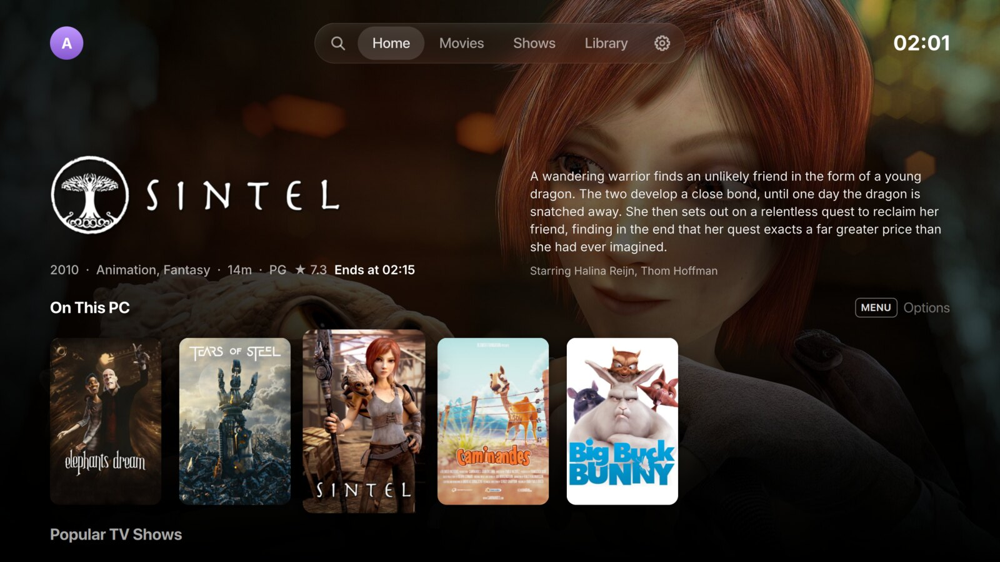
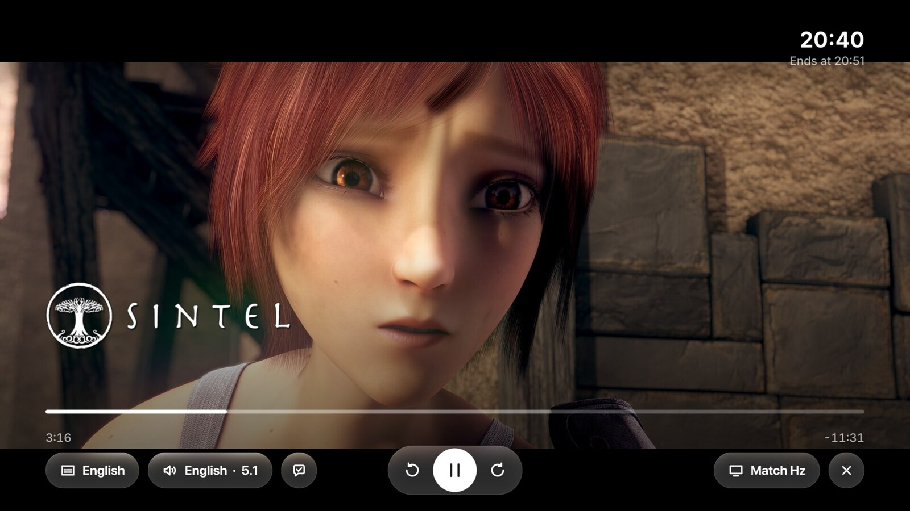
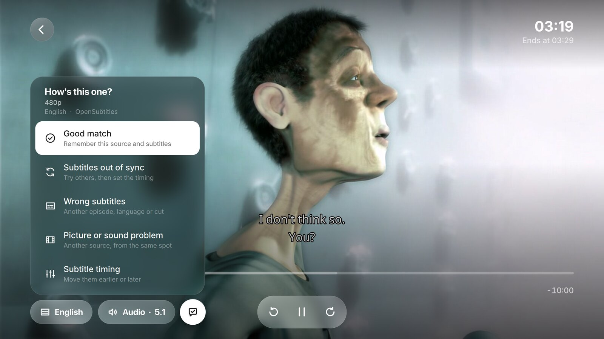
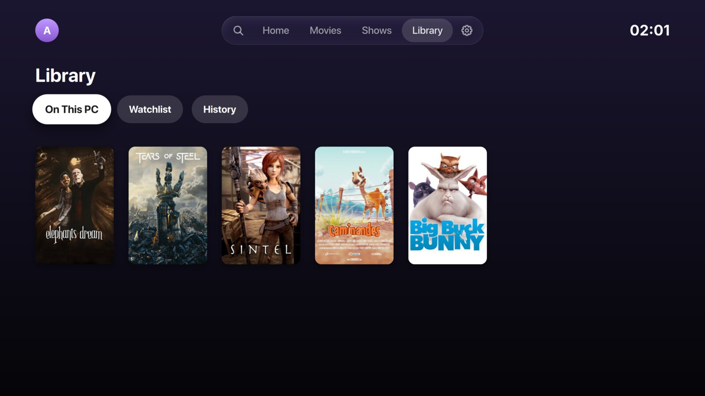
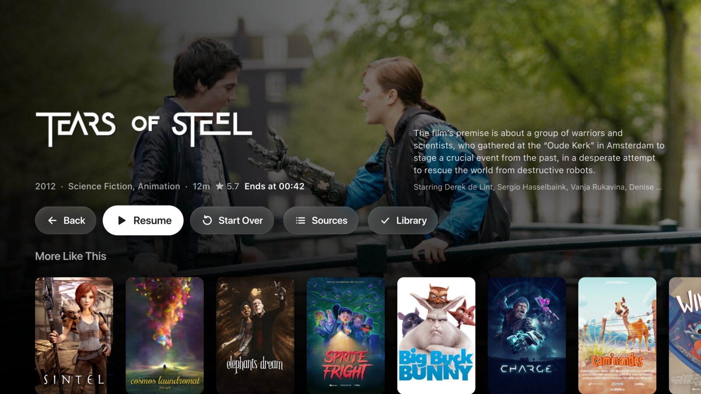

<p align="center">
  
</p>

<h1 align="center">Noonix TV</h1>

<p align="center">
  A cross-platform media player for the living room: browse and play your own movies and shows, and the
  sources you connect, with a remote, a controller or a mouse.
</p>

<p align="center">
  <a href="https://github.com/dzeliks/noonix-tv/actions/workflows/ci.yml"></a>
  <a href="https://github.com/dzeliks/noonix-tv/releases/latest"></a>
</p>

<p align="center">
  
</p>

<table>
  <tr>
    <td></td>
    <td></td>
  </tr>
  <tr>
    <td></td>
    <td></td>
  </tr>
</table>

## Features

- **Your own library first**: point Noonix TV at the folders your movies and shows are in. It
  recognizes them by name, adds posters, seasons and episodes from TMDB, and plays them straight
  from your computer.
- **A home screen built for the couch**: your library, Up Next and Continue Watching (synced with
  Trakt if you like), popular and trending titles, and a full-screen preview of whatever is in
  focus.
- **Bring your own sources**: Noonix TV comes with none. Add Stremio addons or Noonix TV
  [extensions](docs/extensions.md) you choose, from an address or a file; each one shows exactly
  what it adds before you confirm.
- **The best source, picked for you**: your own files come first, then releases in your audio and
  subtitle languages. Releases above what your setup can play move to the bottom with a warning,
  mismatched episodes are ranked down, and unsupported HDR formats are filtered out. Your own
  preferred and hidden release patterns sort the rest. The full list is always one press away.
- **Quality that fits your setup**: a built-in benchmark measures your internet speed and your
  PC's playback performance, then recommends the best picture quality both can handle: Light,
  Full HD, 4K or Maximum.
- **A setup for everyone**: a guided first run that works with just the remote and sensible
  defaults for beginners, with every folder, language and addon open to fine-tuning for advanced
  users.
- **A real player**: mpv with HDR support, refresh rate matching per video, intro and credits
  skipping, and a next-episode prompt at the end.
- **Fixes in one step**: report a source as out of sync, wrong subtitles or a picture problem and
  Noonix TV finds a better one, resuming at the same spot. The choice carries over to the next
  episodes.
- **Subtitles that just work**: embedded tracks first, then OpenSubtitles, with an option to
  treat Serbian, Croatian and Bosnian as one language.
- **Any input**: remotes, PlayStation, Xbox and Nintendo controllers with matching button
  glyphs, mouse and keyboard. Every button can be remapped.
- **For the whole household**: multiple profiles, each with its own Trakt account and
  history, in English and Serbian.

## Extensions

An extension is one small `.noonix` file that sets up Stremio addons, torrents and release
patterns in one step, to share a setup or move it to another device. The
[extension guide](docs/extensions.md) has the format, a worked example, how to make any addon rank
well, and how to write your own.

## Download

Get the latest build from [Releases](https://github.com/dzeliks/noonix-tv/releases/latest).

**Linux**: `Noonix-TV-<version>-x86_64.AppImage` runs on Ubuntu 22.04, Debian 12, Fedora 36 and
newer. It is self-contained.

```sh
chmod +x Noonix-TV-*.AppImage
./Noonix-TV-*.AppImage
```

**Windows**: `Noonix-TV-<version>-windows-x64-setup.exe` runs on Windows 10 and 11. It
installs per user without admin rights and is self-contained.

Both update themselves from Settings › About.

**macOS** (preview): `noonix-tv-<version>-macos-universal.zip`, one app for Apple silicon and
Intel, on macOS 26 or newer. Not notarised yet, so the first launch says
Apple could not verify it: click Done, then System Settings › Privacy & Security › Open Anyway.
Or once in Terminal: `xattr -dr com.apple.quarantine "/Applications/Noonix TV.app"`.

## Build from source

Linux: Qt 6.8+, libmpv, SDL3, wayland-protocols, CMake, Ninja and Rust:

```sh
cmake -S . -B build -G Ninja -DCMAKE_BUILD_TYPE=Release -DCMAKE_INSTALL_PREFIX="$HOME/.local"
cmake --build build && cmake --install build
```

Windows is cross-built on Linux with llvm-mingw in Docker:

```sh
docker build -t noonix-wincross tools/windows
docker run --rm -v "$PWD:/src:ro" -v "$PWD/build-win:/build" noonix-wincross \
    bash -c '/src/tools/windows/deps.sh /build/prefix && /src/tools/windows/build.sh /build/prefix /build/cmake /build/out'
```

macOS: `mac/build.sh` on a Mac with the command line tools and Rust.

## Your responsibility

Noonix TV is only a player. It comes with no videos and no sources, and it doesn't host, index or
link to any. It plays the files on your computer and whatever addons or extensions you add
yourself; the people who run those answer for what they offer. Only watch, stream or download
videos you have the right to, and follow the law where you live. The app asks you to agree to the
[terms of use](TERMS.md) on its first run.

## License

Free software under the [GNU GPL v3.0 or later](LICENSE). Builds link GPL builds of mpv and
FFmpeg. Every bundled library is listed with its license in the app's `THIRD-PARTY.txt`.

The screenshots show the Blender open movies Sintel, Tears of Steel, Elephants Dream, Big Buck
Bunny, Caminandes, Cosmos Laundromat, Sprite Fright, Charge and Wing It!, © Blender Foundation |
[blender.org](https://www.blender.org), under [CC BY 3.0](https://creativecommons.org/licenses/by/3.0/)
or [CC BY 4.0](https://creativecommons.org/licenses/by/4.0/).


This product uses TMDB and the TMDB APIs but is not endorsed, certified, or otherwise approved by
TMDB. Watch history comes from [Trakt](https://trakt.tv), extra subtitles from
[OpenSubtitles.com](https://www.opensubtitles.com) and skip times from IntroDB. Noonix TV isn't
affiliated with any of them.

Made with ❤️ by [aleksa.sh](https://aleksa.sh).
